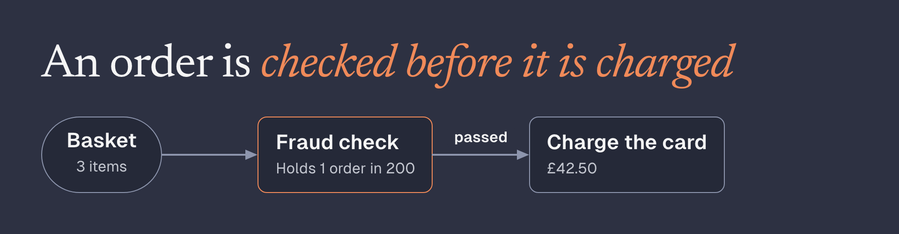
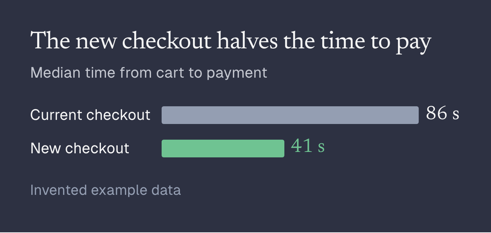

# figkit

Explanatory figures from a little HTML or a chart spec. You write boxes, arrows and labels as ordinary HTML (or give a
chart's data as JSON); a headless browser does the layout, figkit routes the arrows, measures the result and tells you
what is wrong with it: text that is too small or runs out of its box, boxes that overlap, arrows that cross, too many
words for one picture. You get a PNG to embed in a chat, a doc or an issue.

It was written for AI agents that explain things to people, so the rules live in one file an agent can read
([GUIDE.md](GUIDE.md)), and every problem comes back as a sentence that says what to change. People can use it the
same way.

## Install

Node 20 or later, and a Chromium-based browser: figkit uses Chrome or Edge if one is installed, otherwise run
`npx playwright install chromium` once.

```
npm install @liggi/figkit
npx figkit guide        # prints GUIDE.md, the rules for writing figures
```

## A figure from HTML

Save this as `order.html`:

```html
<main class="fig">
  <header>
    <h1>An order is <em>checked before it is charged</em></h1>
  </header>
  <div class="row wide">
    <div class="node pill" id="cart"><h3>Basket</h3><p>3 items</p></div>
    <div class="node accent" id="check"><h3>Fraud check</h3><p>Holds 1 order in 200</p></div>
    <div class="node" id="pay"><h3>Charge the card</h3><p>£42.50</p></div>
  </div>
  <fig-arrow from="cart" to="check"></fig-arrow>
  <fig-arrow from="check" to="pay" label="passed"></fig-arrow>
</main>
```

```
npx figkit order.html --out order.png
```



## A chart from a spec

For one chart of a known type (`split`, `bars`, `before-after`, `dumbbell`, `series`, `groups`, `lines`, `panels`,
`heatmap`), or an `entities` picture of records and the references between them, give the data and figkit does the
rest, including the layout. Add `"style": "report"` for a light chart that sits in a page. Save this as `checkout.json`:

```json
{ "type": "bars", "title": "The new checkout halves the time to pay",
  "note": "Median time from cart to payment", "unit": " s",
  "bars": [ { "label": "Current checkout", "value": 86 },
            { "label": "New checkout", "value": 41, "tone": "good" } ],
  "source": "Invented example data" }
```

```
npx figkit checkout.json --out checkout.png
```



A spec that breaks a rule is refused before anything is drawn, with one line per problem, for example a title over
14 words or a split with more than 8 parts.

## How problems are reported

Each run prints the PNG's path, a preview of how it sits inline on a phone, and the problems the checks found. Here
is the figure above with `class="row arrows middle"` instead of `class="row wide"`:

```
3 problems:
  - #check overlaps the label of arrow check → pay.
  - #pay overlaps the label of arrow check → pay.
  - Almost aligned but not quite: #cart and #check (top edges, 2px apart); #cart and #check (bottom edges, 2px apart);
    #cart and #pay (top edges, 2px apart); #cart and #pay (bottom edges, 2px apart). Put them in one row, column or
    grid so they share the edge.
```

Fix them and run it again until it says `No problems found by the checks.` The checks measure the rendered page; they
cannot tell whether the picture is clear or true, so look at it.

A figure whose columns are two sides to compare can add `class="sides"` to the row that holds them; figkit then also
writes `name.phone.png`, the same figure with the columns stacked, for viewers that show it on narrow screens.

## Examples

`examples/` has a figure of each kind, all with invented data: a flow with a loop and decisions, a boundary between
two systems, a screenshot with a note, before and after, side by side, a split bar, line and timeline charts made
with [Observable Plot](https://observablehq.com/plot/), and `examples/charts/` has one spec per chart type. From a
clone, `npm run examples` renders them all into `out/` and fails if any reports a problem.

## Licence

MIT. figkit's bundle includes Observable Plot and d3 (ISC); see [THIRD_PARTY_NOTICES.md](THIRD_PARTY_NOTICES.md). The
fonts (Newsreader, Geist) are installed as dependencies under the SIL Open Font License.
